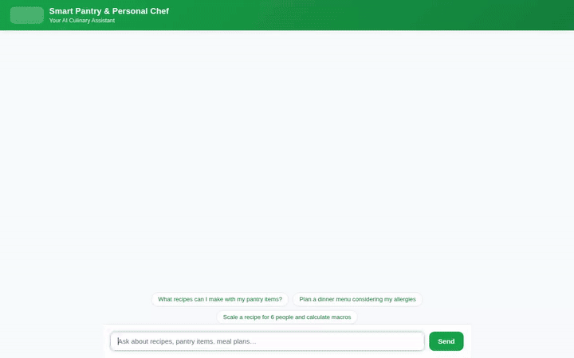

# Smart Pantry & Personal Chef Concierge

An intelligent, multi-modal AI culinary concierge built with the **Google Agent Development Kit (ADK)**, **Gemini**, **Cloud Firestore**, and **Google Cloud Storage**. The agent assists users with personalized meal planning, dietary allergy management, pantry ingredient tracking, recipe scaling, grocery store discovery, and multi-modal image and video generation for recipes.



---

## 🌟 Key Features & Capabilities

All capabilities listed below are fully implemented in the `app/` codebase:

- **Dietary & Allergy Memory Bank (`load_memory` / `preload_memory`)**: Automatically stores and recalls user food allergies (e.g., peanuts, shellfish, dairy, gluten) and dietary preferences across chat sessions using ADK Memory Bank integration.
- **Cloud Firestore Pantry & Recipe Store**:
  - `get_pantry_items` & `add_pantry_item`: Queries and updates available user ingredients stored in Cloud Firestore (`pantry` collection).
  - `search_recipes` & `add_recipe`: Searches and saves safe recipes in Cloud Firestore (`recipes` collection), cross-referencing ingredients against stored user allergies.
- **Multi-Modal Dish Video Generation (`generate_dish_video`)**: Generates dish preparation videos using **Google Omni (`gemini-omni-flash-preview`)** in location `global`. Automatically saves video artifacts via `tool_context.save_artifact()` for the ADK Playground and uploads raw bytes directly to a public Cloud Storage bucket.
- **Multi-Modal Dish Image Generation (`generate_dish_image`)**: Generates culinary visuals using Google GenAI models, saving artifacts and returning public Cloud Storage HTTPS links for inline display.
- **Culinary Math & Unit Conversion (`calculate` / `unit_converter`)**: Safely scales recipes (for $N$ servings) and converts culinary measurements (cups, tbsp, tsp, grams, oz, lbs, ml, liters) using safe AST Python evaluation.
- **Supermarket & Address Finder (`geocode_address` / `find_nearby_places`)**: Integrates Google Maps Geocoding and Places API to locate nearby grocery stores and specialty food markets.
- **Structured A2UI Interface**: Delivers dynamic UI cards (`Card`, `Column`, `Row`, `Text`, `Image`) formatted through the Agent-to-User Interface (A2UI) protocol.

### 📋 Planned / Future Capabilities
- **Automatic Barcode & Receipt Scanning**: Planned for future release (not currently implemented).

---

## 🏗️ Architecture & Technology Stack

- **Framework**: Google Agent Development Kit (ADK)
- **Model**: `gemini-flash-latest` (Interactions API / `gemini-omni-flash-preview` for video)
- **Backend & Database**: Google Cloud Firestore, Google Cloud Storage, Agent Engine
- **Frontend**: Lightweight FastAPI proxy and plain HTML5/CSS3/JavaScript chat interface
- **Deployment**: Google Cloud Agent Runtime / Cloud Run

---

## 🚀 Local Setup & Running Instructions

### 1. Install Dependencies
```bash
pip install -r requirements.txt
```

### 2. Configure Environment Variables
Set the deployed Agent Engine resource name and agent directory:
```bash
export AGENT_ENGINE_RESOURCE_NAME="projects/<PROJECT_ID>/locations/<REGION>/reasoningEngines/<REASONING_ENGINE_ID>"
export AGENT_DIRECTORY="app"
```

### 3. Start Local Frontend Server
```bash
cd frontend
python main.py
```
The frontend server will start and serve the chat interface on port `8080`.

---

## 📦 Deployment Instructions

### Deploy Agent to Agent Runtime
```bash
agents-cli deploy --no-confirm-project
```

### Deploy Frontend to Cloud Run
```bash
gcloud run deploy smart-pantry-frontend \
  --source ./frontend \
  --region us-east1 \
  --allow-unauthenticated \
  --set-env-vars="AGENT_ENGINE_RESOURCE_NAME=$AGENT_ENGINE_RESOURCE_NAME,AGENT_DIRECTORY=$AGENT_DIRECTORY"
```
